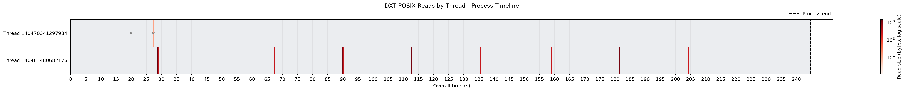
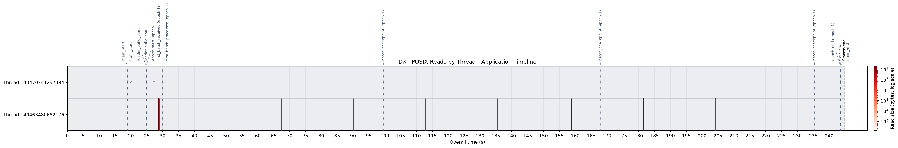
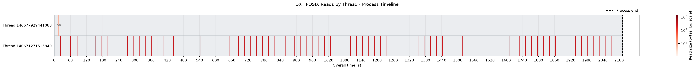
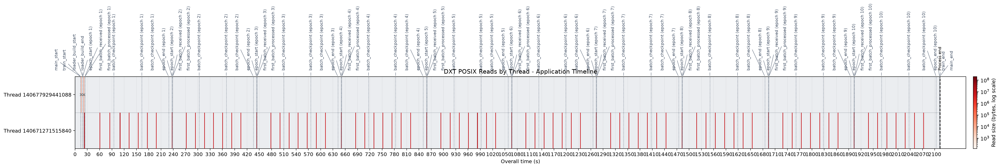
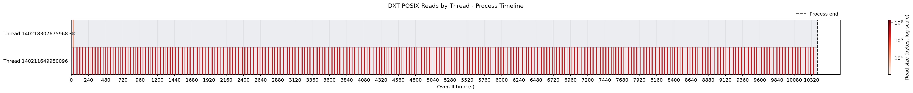
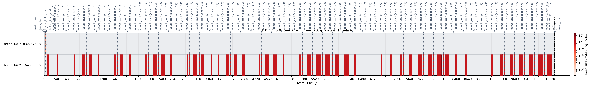

# Placing events during execution in a Darshan-instrumented workflow

Three notebooks are presented in which Darshan logs parsed to json are explored. Values explorations and a filtering by file process is implemented as part of this exploration.

Debug messages are included in machine learning workflows (`scripts/root_tr_9.py`) and used to locate events in a timeline together with a heatmap of POSIX I/O activity measured by Darshan.

The given notebooks `test_on_epochs_1.ipynb`, `test_on_epochs_10.ipynb` and `test_on_epochs_50.ipynb` work, respectively, on Darshan logs collected from the same machine learning training process: MLP (64, 128, 64) for a binary classification problem in a ROOT dataset of 10 million of events with 18 numerical features an 1 target label across different number of epochs (1, 10, 50). The same process is implemented in all notebooks to generate the events-in-timeline graphs so a review of one of them is enough to understand the proposed approach.

### Figures

#### 1 epoch:

#### 10 epoch2:

#### 50 epochs:

